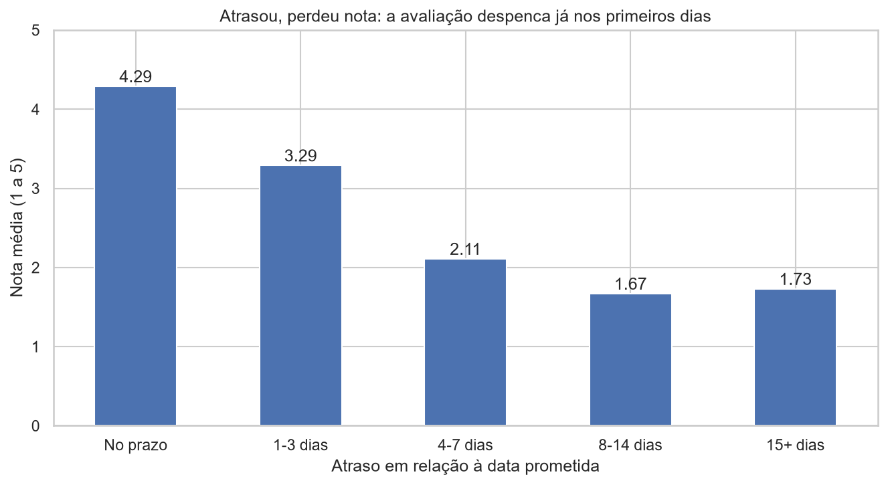
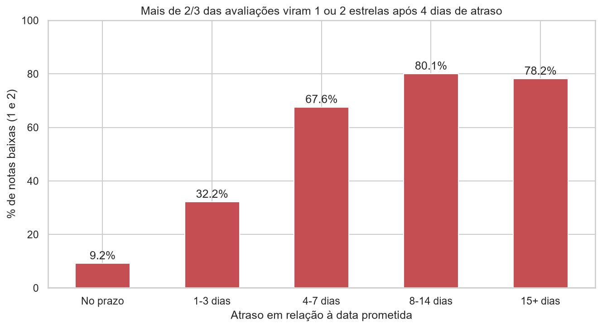
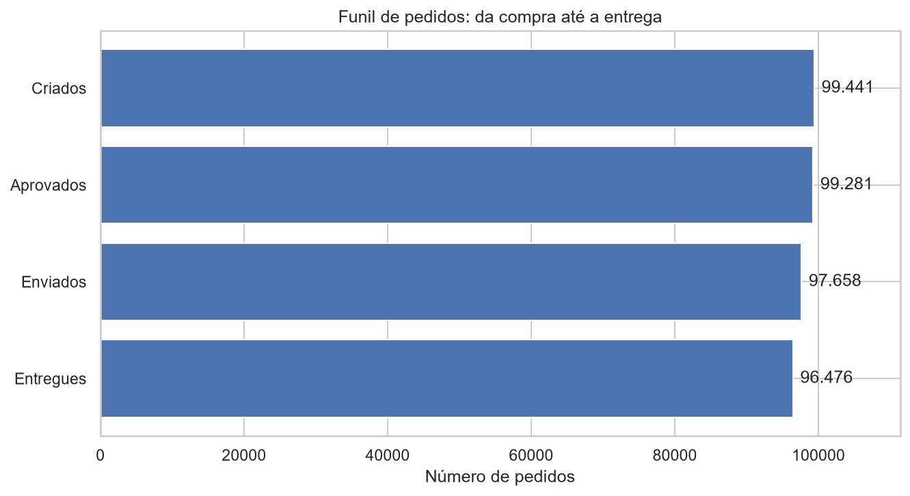
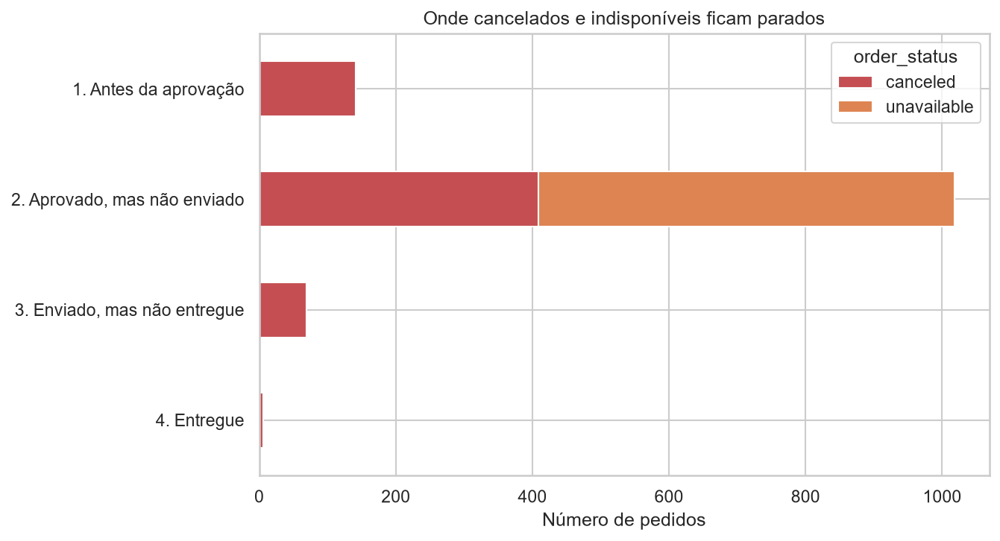
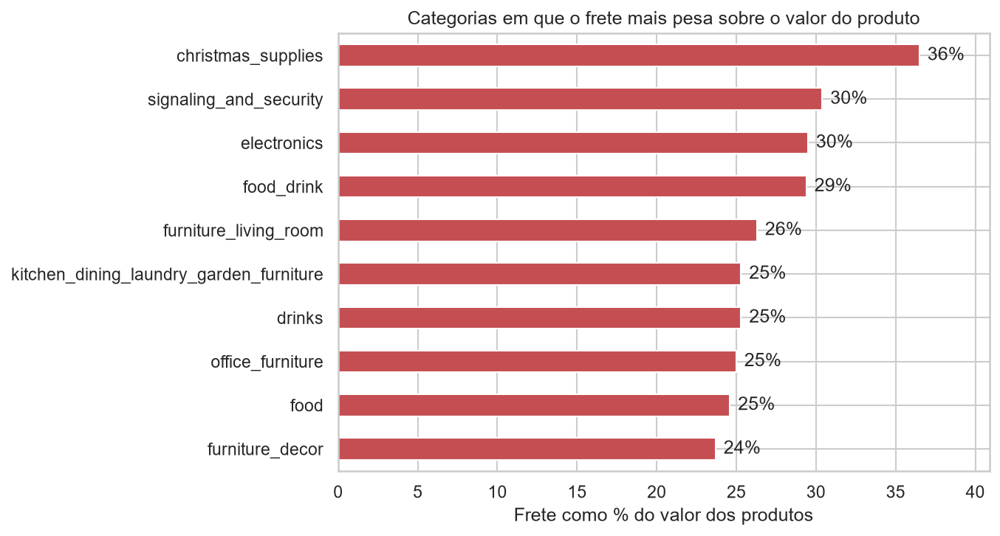
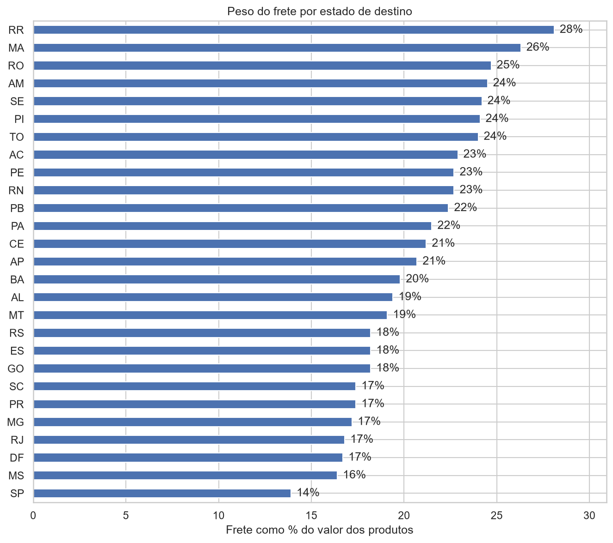
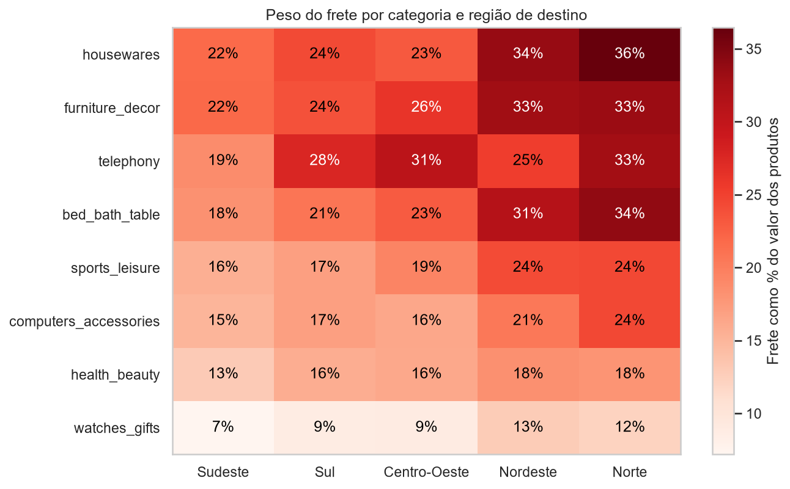
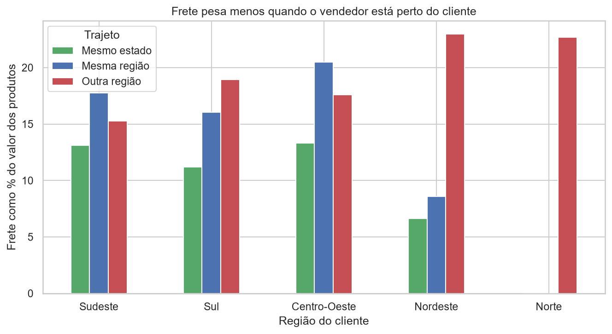
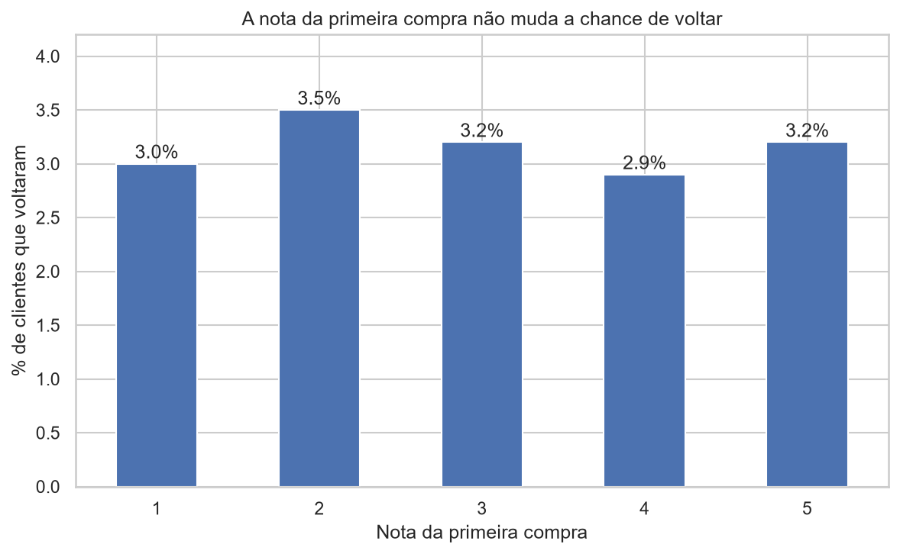

# Perguntas de negócio: Olist Brazilian E-commerce

Análises rápidas que respondem a perguntas de negócio com os dados públicos do marketplace [Olist](https://www.kaggle.com/datasets/olistbr/brazilian-ecommerce) (cerca de 100 mil pedidos entre 2016 e 2018). Cada notebook parte de uma pergunta, entrega a resposta logo no início, mostra a evidência (SQL + pandas + gráficos) e termina com o insight para o negócio e as limitações da análise.

**Ferramentas:** PostgreSQL (Docker), SQL, Python, pandas, SQLAlchemy, matplotlib, seaborn, Jupyter.

## Resumo das análises

| # | Pergunta | Resposta em uma linha | Notebook |
|---|----------|------------------------|----------|
| 1 | O atraso na entrega derruba a nota de avaliação? | Sim: nota média de 4,29 no prazo contra 2,27 nos atrasados; os atrasos (6,7% dos pedidos) geram 32,5% das notas baixas. | [01_atraso_vs_avaliacao](01_atraso_vs_avaliacao.ipynb) |
| 2 | Onde os pedidos se perdem? | 97% chegam ao cliente; 82,5% dos cancelados e indisponíveis ficam parados entre a aprovação e o envio, ou seja, no vendedor. | [02_funil_pedidos](02_funil_pedidos.ipynb) |
| 3 | Onde o frete pesa mais? | Em produtos baratos e em destinos distantes dos vendedores: de 14% (SP) a 28% (RR) do valor dos produtos. | [03_peso_do_frete](03_peso_do_frete.ipynb) |
| 4 | Quantos clientes voltam a comprar? | Quase ninguém: 97% compram uma única vez e a recompra é de 3,0%. | [04_recompra_clientes](04_recompra_clientes.ipynb) |

---

## 1. O atraso na entrega derruba a nota de avaliação?

**Resposta:** sim, e a queda começa logo nos primeiros dias.

- Pedidos no prazo têm nota média de **4,29**; os atrasados, **2,27**.
- Com 1 a 3 dias de atraso a nota já cai para 3,29, e a partir de 4 dias mais de dois terços das avaliações são de 1 ou 2 estrelas (67,6% a 80,1%).
- Depois de 8 dias a nota estabiliza em torno de 1,7: o estrago já está feito.
- Os atrasos são raros (**6,7%** dos pedidos), mas respondem por **32,5%** de todas as notas baixas.

  

  

**Insight e ação:** o maior ganho está em evitar atrasos acima de 3 dias e em prometer prazos mais realistas nas regiões onde o atraso é recorrente.

**Observação metodológica:** atraso = entrega real posterior à data estimada; apenas pedidos `delivered`; pedidos com mais de uma avaliação usam a nota média. A análise mostra associação, não causalidade.

---

## 2. Onde os pedidos se perdem?

**Resposta:** a perda é pequena, mas concentrada no vendedor.

- De 99.441 pedidos criados, **96.476 (97,0%)** chegam ao cliente.
- A maior perda entre etapas está entre a aprovação do pagamento e o envio (1,6% dos pedidos).
- Dos 1.234 pedidos cancelados ou indisponíveis, **82,5% (1.018)** ficaram parados entre a aprovação e o envio. Todos os 609 pedidos `unavailable` morreram nessa etapa.

  

  

**Insight e ação:** o cliente já pagou e o pedido não sai, o que sugere falta de estoque no momento da venda (hipótese, o dataset não informa o motivo). Vale monitorar a taxa de cancelamento por vendedor e sinalizar os que perdem pedidos de forma recorrente nessa fase.

**Observação metodológica:** nem toda a perda do funil é cancelamento; parte dos pedidos pode simplesmente estar sem atualização de status no fim do dataset.

---

## 3. Onde o frete pesa mais?

**Resposta:** em produtos de ticket baixo e em destinos distantes dos vendedores, e os dois efeitos se somam.

Métrica: frete como % do valor dos produtos (soma do frete ÷ soma dos preços), apenas pedidos entregues.

**Por categoria**

- Nas 10 categorias mais afetadas o frete pesa de 24% a 36% do valor do produto.
- Há dois perfis: ticket baixo (eletrônicos, alimentos, bebidas), com preço médio de R$ 55 a R$ 60 e frete de R$ 14 a R$ 21; e móveis, com os maiores fretes em reais, mas preço mais alto.
- O peso do produto sozinho não explica o ranking: eletrônicos pesam cerca de 770 g e ainda assim chegam a 29,5%. O frete de R$ 14 a R$ 17 mesmo em itens leves sugere um piso de frete.

  

**Por estado de destino**

- O peso do frete vai de **14% em SP** a **28% em RR**.
- Os sete estados com maior peso são todos do Norte e do Nordeste (RR, MA, RO, AM, SE, PI, TO).

  

**Categoria × região**

- Todas as 8 categorias mais vendidas ficam mais pesadas do Sudeste ao Norte, de **1,39x** (`health_beauty`) a **1,85x** (`bed_bath_table`).
- A categoria define o patamar (7% em `watches_gifts` no Sudeste, 36% em `housewares` no Norte) e a região multiplica esse patamar.

  

**Distância do vendedor**

- Os vendedores estão concentrados no Sudeste: a região origina de 76% a 85% dos itens de todos os destinos, e **84%** dos itens enviados ao Norte e ao Nordeste.
- Quando vendedor e cliente estão no mesmo estado, o frete pesa menos em todas as regiões com dados. No Nordeste: **6,6%** (mesmo estado) contra **23,0%** (outra região), 3,5 vezes menos.

  

**Insight e ação:** produtos baratos sentem mais o frete mínimo, e quem compra no Norte e no Nordeste quase sempre recebe de longe. Ações possíveis: atrair vendedores dessas regiões, frete grátis acima de um valor mínimo ou desconto em pedidos combinados nas categorias de ticket baixo, e avaliar estoque ou parceria logística regional no Nordeste.

**Limitações:** a comparação por trajeto não controla o mix de produtos; região é uma medida grosseira de distância (a distância em km, com latitude e longitude, seria mais precisa); os dados mostram associação, não causalidade; categorias pequenas e sazonais (artigos de Natal, 150 itens) são menos estáveis.

---

## 4. Quantos clientes voltam a comprar?

**Resposta:** quase ninguém.

- **97,0%** dos clientes compraram uma única vez; a taxa de recompra é de **3,0%** (3,1% em até 180 dias, entre os 55.907 clientes que tiveram tempo de voltar).
- **30,5%** das recompras acontecem em menos de 24 horas, o que sugere pedidos divididos mais do que fidelização. Sem eles, a taxa cai para cerca de **2,1%**.
- Metade das recompras (50,8%) acontece no primeiro mês.
- A nota da primeira compra não muda a chance de voltar: de 2,9% a 3,5%, sem tendência.

  

  

**Insight e ação:** a recompra é um ponto fraco estrutural, e melhorar a satisfação sozinha não parece trazer o cliente de volta. A janela mais promissora é o primeiro mês. Ações a testar: reengajamento nos primeiros 30 dias, incentivo de frete na segunda compra e segmentação de clientes (RFM).

**Observação metodológica:** o cliente é identificado por `customer_unique_id`, e não por `customer_id`, que muda a cada pedido (96.478 pedidos e 96.478 `customer_id`, mas 93.358 clientes únicos). Usar o `customer_id` resultaria em 0% de recompra.

---

## Como reproduzir

1. Suba o PostgreSQL (Docker) e carregue as tabelas do dataset Olist.
2. Configure a conexão em `src/config.py` (`DATABASE_URL`), que os notebooks importam.
3. Instale as dependências: `pandas`, `sqlalchemy`, `psycopg2-binary`, `matplotlib`, `seaborn` e `jupyter`.
4. Execute os notebooks na ordem (`01` a `04`).

## Limitações gerais

- Os dados cobrem cerca de dois anos de um marketplace em crescimento e só registram compras feitas na própria plataforma.
- Todas as análises mostram associações, não relações de causa e efeito. As "ações" são hipóteses a testar.
